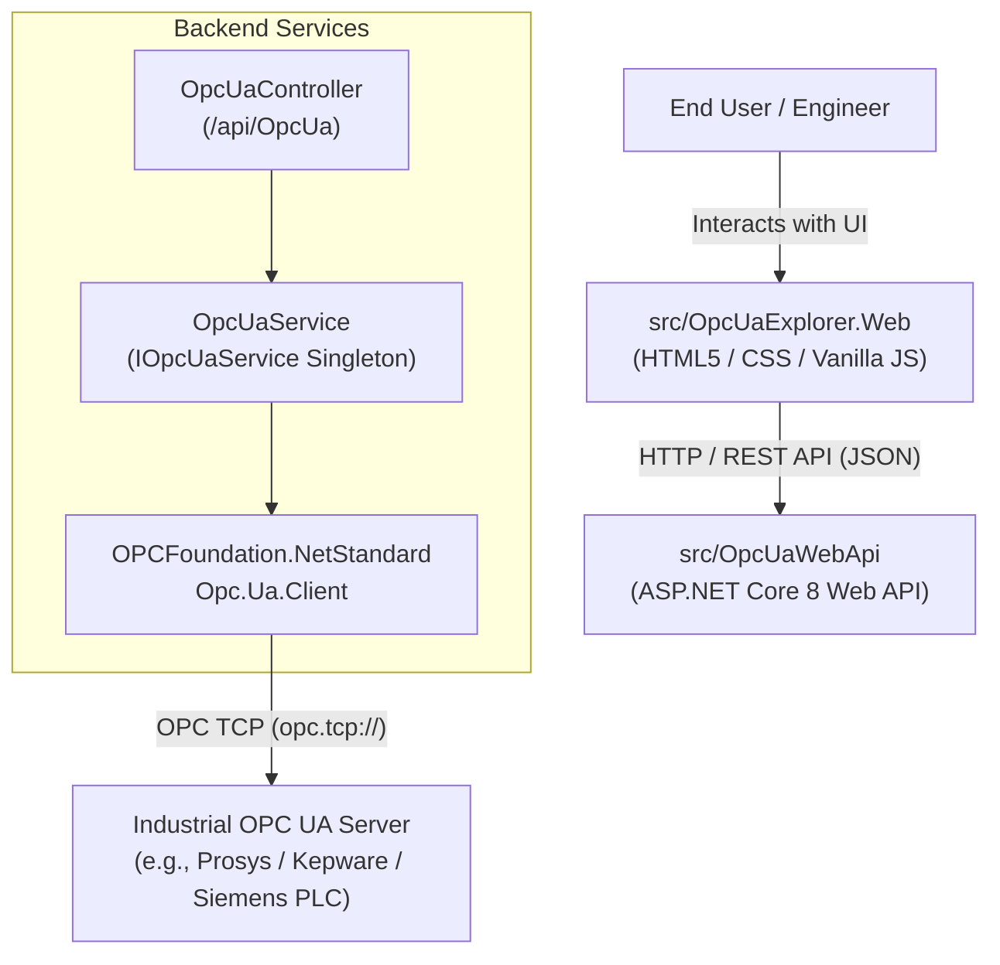

# System Architecture

This document describes the architectural design and communication flow of the OPC UA Explorer & Web API solution.

---

## 1. High-Level Architecture Diagram

---

## 2. Component Details

### A. Frontend (`src/OpcUaExplorer.Web`)
- Lightweight, zero-dependency browser client.
- Features:
  - Dynamic connection bar to specify target OPC UA server endpoint.
  - Interactive hierarchical tree view for browsing Object and Variable nodes.
  - Detail pane showing NodeId, DisplayName, DataType, Value, and Timestamp.
  - Real-time refresh support.

### B. Backend (`src/OpcUaWebApi`)
- **Controller Layer (`OpcUaController`)**:
  - Exposes REST endpoints to bridge HTTP clients with the OPC UA stack.
- **Service Layer (`IOpcUaService` / `OpcUaService`)**:
  - Manages OPC UA `ApplicationConfiguration`, security certificates, and active `ISession`.
  - Implements recursive browsing with depth control (`maxDepth`).
  - Converts OPC UA `DataValue` structures to serializable DTOs.
- **Session Management**:
  - Configured as a Singleton service in ASP.NET Core DI container so an active session remains alive across consecutive HTTP requests until explicitly disconnected or timed out.

### C. OPC UA Server Integration
- Communicates using the standard binary OPC UA TCP protocol (`opc.tcp://`).
- Supports Anonymous or User Identity authentication and configurable message security modes.
